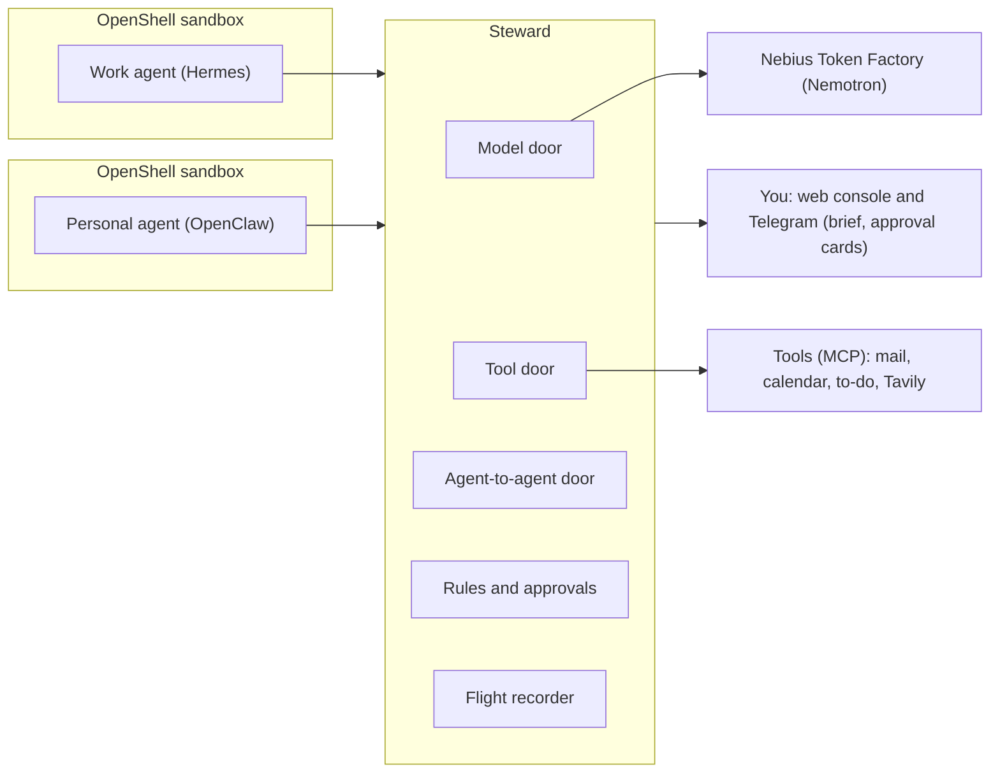

# Steward

Steward is a self-hosted gatekeeper between the AI agents you run and everything they can reach: models, tools and each other. It is built for the Nebius x NVIDIA Global AI Hackathon, Personal AI track.

Status: Phase 1 (the two doors). The model door, the tool door and the agent-to-agent door (Availability only) run, with a hash-chained flight log and an admin API. Rules that hold and approval cards come in Phase 2.

## The problem

People now run more than one agent. A work agent has the work email and calendar. A personal agent has the personal Gmail and calendar. They are more useful when they coordinate, but today you connect them fully or not at all. Steward lets them share the constraint and keeps the reason private.

Example: the work agent plans a client trip to Manchester and asks the personal agent about 12 to 15 October.

| Full answer                                           | What Steward lets through                |
| ----------------------------------------------------- | ---------------------------------------- |
| Wed 14 Oct, 2:15pm, cardiology follow-up with Dr Shah | Wed 14 Oct, 2pm to 4pm, busy, can't move |

Steward guards against four things:

- Oversharing, as in the example above.
- Prompt injection that makes one agent ask the other for private data.
- Small answers pieced together into something private.
- Two agents overwriting the same calendar or list.

## How it works

Every agent reaches the outside world through one of three doors.

| Door           | What it is              | What it does                                                                                                                                                                                   |
| -------------- | ----------------------- | ---------------------------------------------------------------------------------------------------------------------------------------------------------------------------------------------- |
| Model          | OpenAI-compatible proxy | Sends every model call to Nemotron on Nebius Token Factory. Holds the real key, picks the model for each agent and meters spend.                                                               |
| Tool           | MCP gateway             | Each agent sees only the tools on its pass.                                                                                                                                                    |
| Agent-to-agent | Fixed request types     | Agents ask each other only for availability, travel limits, dietary and access needs, change notices, or an address stand-in for one booking. Code checks every request and trims every reply. |

Plain code decides what passes in version 1. A model only writes the morning brief and explains approval cards. Agents hold a pass and never a provider key. Anything risky is held for you as an approval card. Every call is recorded in a hash-chained log that can be replayed.

## Sandboxes

Each agent runs inside its own NVIDIA OpenShell sandbox with a default-deny network. The only allowed destination is Steward, reached as `host.openshell.internal:8000`. The agent sees a placeholder for its pass, and OpenShell swaps in the real pass on the way out.

Steward is the guard at the door. OpenShell makes sure the door is the only way out. NemoClaw is not used because Steward already does model routing, tool gating and key custody.

## Architecture



## Models

All models are served through Token Factory.

| Role                                             | Model                                                                                                 |
| ------------------------------------------------ | ----------------------------------------------------------------------------------------------------- |
| Work agent (Hermes)                              | `nvidia/nemotron-3-super-120b-a12b`                                                                   |
| Personal agent (OpenClaw) and morning brief      | `nvidia/NVIDIA-Nemotron-3-Nano-30B-A3B` (`nvidia/Nemotron-3_5-Lightning` if Nano is no longer listed) |
| Rare heavy reasoning (skill drafting, diagnosis) | `nvidia/Nemotron-3-Ultra-550b-a55b`                                                                   |
| Red-team rewording and the AI-check ablation     | Nemotron 3 Super                                                                                      |

Token Factory retired several models on 31 Aug 2026. Model IDs are confirmed against the live model list in Phase 0.

## Other NVIDIA and Nebius tools

| Tool                              | Use                                          |
| --------------------------------- | -------------------------------------------- |
| NVIDIA OpenShell                  | Sandbox for each agent                       |
| Hermes Agent (Nous Research, MIT) | Work agent                                   |
| OpenClaw                          | Personal agent                               |
| Tavily                            | Search tool for the work agent, from Phase 2 |

## Roadmap

| Phase                         | Goal                                                                                                  |
| ----------------------------- | ----------------------------------------------------------------------------------------------------- |
| 0 Setup and de-risk           | Both agents call Nemotron and one tool through a stub Steward inside OpenShell sandboxes.             |
| 1 (current) The two doors     | Every model call, tool call and agent-to-agent message goes through Steward and lands in the log.     |
| 2 Rules, holds and approvals  | The Manchester evening runs live and as a replay, and every trap is held or refused.                  |
| 3 Supervisor and hosted demo  | Overnight watcher and morning brief. Anyone with the link can try replay and playground.              |
| 4 Proof and ablations         | One command produces a results table comparing code checks with an AI check (Nemotron judge) and Jev. |

## Repository layout

| Folder                             | What goes there                                       |
| ---------------------------------- | ----------------------------------------------------- |
| `apps/gateway`                     | Steward gateway: model, tool and agent-to-agent doors |
| `apps/worker`                      | Watcher, brief, red-team runs                         |
| `apps/web`                         | Console (React, Vite, Tailwind)                       |
| `packages/core`                    | Request types, rules, checkers, flight log            |
| `packages/fixtures`                | Synthetic work and personal data with planted details, served as MCP tools |
| `config`                           | The policy file `steward.yaml`                        |
| `agents/openshell`                 | Sandbox policy and Steward provider profiles          |
| `agents/hermes`, `agents/openclaw` | Sandbox images and configs                            |
| `skills`                           | Agent skills                                          |
| `evals`                            | Traps and ablation runs                               |
| `deploy`                           | Compose, Caddy later                                  |
| `spikes`                           | Check scripts for the live system                     |
| `docs`                             | Notes, ADRs                                           |

## Development

Requires uv and Python 3.12.

Secrets: copy `.env.example` to `.env` and fill it in yourself. `.env` is gitignored. The policy file `config/steward.yaml` (agents, models, tools, who may ask whom) is committed and holds no secrets; it names the environment variable that holds each agent's pass.

Checks (the same as CI):

```bash
uv sync --all-packages --locked
uv run ruff check . && uv run ruff format --check . && uv run mypy && uv run pytest
```

Run Steward (on the VM, one worker, because open agent-to-agent requests live in memory):

```bash
uv run --package steward-gateway --env-file .env uvicorn steward_gateway.app:app --host 0.0.0.0 --port 8000
```

| Route | Who | What |
| --- | --- | --- |
| `/v1/models`, `/v1/chat/completions` | agents (pass) | Model door |
| `/tools/<agent>/mcp` | agents (pass) | Tool door, including `ask` and `reply` |
| `/admin/*` | owner token | Agents, log, live log stream, chain verify, export, tool pins |
| `/console` | owner | The web console, served from `apps/web/dist` |
| `/healthz` | anyone | Health check |

The flight log is one SQLite file (`STEWARD_DB_PATH`, default `var/steward.db`).

## Docs

- [Demo story: the Manchester trip](docs/demo-story.md)
- [Features](docs/features.md)
- [Questions and doubts](docs/questions-and-doubts.md)
- [Feedback log](FEEDBACK.md)

## Licence

Apache-2.0, see [LICENSE](LICENSE).
