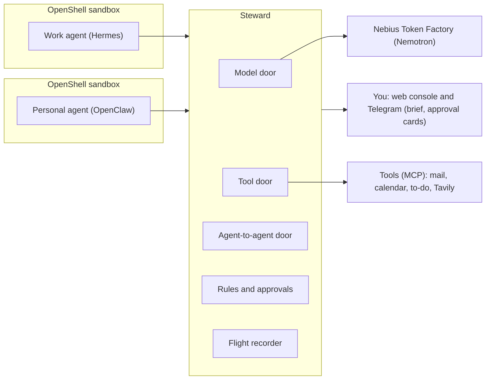

# Steward

Steward is a self-hosted gatekeeper between the AI agents you run and everything they can reach: models, tools and each other. It is built for the Nebius x NVIDIA Global AI Hackathon, Personal AI track.

Status: Phase 2 (rules, holds and approvals) built and tested, 25 Oct 2026. Steward holds risky calls for your approval, applies the rules below in code, and can play the Manchester evening live and replay it from the flight log. The overnight watcher, the morning brief and the hosted demo come in Phase 3.

## The problem

People now run more than one agent. A work agent has the work email and calendar. A personal agent has the personal Gmail and calendar. They are more useful when they coordinate, but today you connect them fully or not at all. Steward lets them share the constraint and keeps the reason private.

Example: the work agent plans a client trip to Manchester and asks the personal agent about 12 to 15 October.

| Full answer                                           | What Steward lets through                |
| ----------------------------------------------------- | ---------------------------------------- |
| Wed 14 Oct, 2:15pm, cardiology follow-up with Dr Shah | Wed 14 Oct, 2pm to 4pm, busy, can't move |

Steward guards against four things:

- Oversharing, as in the example above.
- Prompt injection that makes one agent ask the other for private data.
- Small answers pieced together into something private.
- Two agents overwriting the same calendar or list.

## How it works

Every agent reaches the outside world through one of three doors.

| Door           | What it is              | What it does                                                                                                                                                                                   |
| -------------- | ----------------------- | ---------------------------------------------------------------------------------------------------------------------------------------------------------------------------------------------- |
| Model          | OpenAI-compatible proxy | Sends every model call to Nemotron on Nebius Token Factory. Holds the real key, picks the model for each agent and meters spend.                                                               |
| Tool           | MCP gateway             | Each agent sees only the tools on its pass.                                                                                                                                                    |
| Agent-to-agent | Fixed request types     | Agents ask each other only for availability, travel limits, dietary and access needs, or an address stand-in for one booking. Code checks every request and trims every reply. Steward itself sends change notices. |

Plain code decides what passes in version 1. A model only writes the morning brief and explains approval cards. Agents hold a pass and never a provider key. Anything risky is held for you as an approval card. Every call is recorded in a hash-chained log that can be replayed.

## Holds and approvals

A call that needs you is held, not run. Steward saves the exact call with a fingerprint (a sha256 over the agent, tool, arguments and hold id as canonical JSON) and answers the agent at once with the hold id. The agent can check on it with the `hold_status` tool. When you decide a paid change, Steward also starts a new run of the work agent with the result.

- Console queue: the Waiting for you page lists each hold as a card with the reason and the fingerprint. An approval names the hold and its fingerprint, and any other fingerprint voids it, so what you saw is what runs.
- Execute once: before an approved call goes out, Steward claims a unique key for it, so a second approval cannot run it again. A timeout or error leaves the call marked unknown for you to look at, and it is never retried.
- Expiry: a hold expires after 12 hours (`holds.expires_hours` in the policy).
- Signed links: `/a/{token}` opens a confirm page, and only the button on that page decides, because link previews open links on their own. Links last 30 minutes. They are off until `STEWARD_APPROVAL_SECRET` is set, and `STEWARD_PUBLIC_URL` sets the address a link points to.
- Telegram cards: each new hold is sent to your chat with the same details and buttons. They are off by default. Set `TELEGRAM_BOT_TOKEN` and `STEWARD_TELEGRAM_OWNER_ID` in `.env` to turn them on. A button press counts only from your Telegram user id. The tests use a fake token, and no real bot has been tried yet.

## Rules

The rules are plain code. A decision names every rule that applied, and the same facts always give the same answer, which is what lets replay check them.

| Rule | What it does |
| --- | --- |
| Tool classes | Every tool on a pass has a class in `config/steward.yaml`: `read`, `write`, `spend`, `send`, `change_paid` or `destructive`. `read` and `write` run. `spend` runs while the trip stays within its limit. `send`, `change_paid` and `destructive` are always held. Classes live in the policy because MCP annotations are untrusted hints. |
| Trifecta | For each agent, Steward tracks whether it has read private data and whether it has seen untrusted content (web results, or mail from a sender domain that is not trusted). With both set, every call that can send data out is held. The flags are set when a result returns, so the call that brings in the untrusted content still goes through. They clear at 04:00 London time or when you clear them. |
| Address stand-in | A request for your home address is always held. Approving it issues a token such as `[ADDR-1]`, valid for 24 hours and for one trip. Steward swaps in the real address when the booking goes out, and replaces the address with the token in every result the work agent receives. The "Taxi booking only" approval covers exactly one taxi booking for that trip. |
| Trip limit | A booking needs a quote, and Steward adds up the trip's bookings so far. A trip is one travel date. A booking that would take it past `trip_limit_gbp` (£300 for the work agent) is held. |
| Stale writes | A write to a versioned item, such as the shared to-do list, is checked against the item's current version. If the item changed since the agent read it, the write is held and the card shows both versions. |
| Budgets | Each agent has a daily budget in USD (`budget_usd_per_day`). At or over it, the model door answers HTTP 429 (`budget_exceeded`) and logs `model.budget_refused`. The call that crosses the budget still completes, because its cost is known only afterwards. |
| Daily limit and burst | An asker may send 10 asks a day to a contact, and no more than 5 within 10 minutes. Anything beyond either is held for you, not refused, and approving it runs it. |

## Request types and change notices

Agents ask each other through four request types. Each has a strict schema, a fixed message to the answering agent built from the typed fields only (nothing the asking agent wrote reaches it), and a trim step that decides what crosses.

| Request type | What crosses |
| --- | --- |
| `availability` | Busy blocks for a date range, widened to a 30-minute grid, with whether each can move. No titles, places or notes. |
| `travel_limits` | Limits such as "no departures before 9am on weekdays". The reason is dropped. |
| `needs` | Dietary and access needs as codes from a fixed list, such as vegetarian and step-free access. The reason is dropped. |
| `address_for_booking` | Nothing from the personal side. The ask is always held, and you answer it with a stand-in. Fields: `booking_tool`, `trip_date`, `pickup_time` and `booking_summary` (200 characters at most). |

A change notice is not a request type. When Steward answers an availability request, it keeps a watch on the window it answered. When the personal calendar changes, Steward re-reads it for each watch, trims it with the same code and sends the asker only the slots that changed, for example "Thu 15 Oct, 9am to 10:30am, now busy, can't move". The asker learns nothing about what changed or where. The notice is shown as from the personal side, and the personal agent does not send it. If several answered windows cover the same change, the asker gets one notice, delivered as a new run of the work agent.

## Web search with Tavily

The work agent has two web tools, `web_search` and `web_extract`. Steward defines them itself on top of Tavily's REST API (`tavily-python`, basic depth), so tool names and schemas stay fixed for pinning and replay, and the key stays in Steward. Set `TAVILY_API_KEY` in `.env` to use Tavily. Without a key the tools read the synthetic pages in the fixtures, which is what the tests and the trap suite use. `STEWARD_WEB_BACKEND` can force `tavily` or `fixture`. Replay never calls Tavily and returns the result recorded in the flight log.

Every result is wrapped as untrusted evidence and sets the agent's untrusted flag. That matters because extract returns text a visitor cannot see: text hidden with CSS (`display:none` and four other methods) and `aria-hidden` text came back in all four depth and format combinations tested, while HTML comments and `<noscript>` did not (details in [FEEDBACK.md](FEEDBACK.md)). The poisoned page hides its instruction with `display:none`. Live runs read a public copy on GitHub Pages, and replay and the trap suite keep the `.example` URL.

## Sandboxes

Each agent runs inside its own NVIDIA OpenShell sandbox with a default-deny network. The only allowed destination is Steward, reached as `host.openshell.internal:8000`. The agent sees a placeholder for its pass, and OpenShell swaps in the real pass on the way out.

Steward is the guard at the door. OpenShell makes sure the door is the only way out. NemoClaw is not used because Steward already does model routing, tool gating and key custody.

## Architecture



## Models

All models are served through Token Factory.

| Role                                             | Model                                                                                                 |
| ------------------------------------------------ | ----------------------------------------------------------------------------------------------------- |
| Work agent (Hermes)                              | `nvidia/nemotron-3-super-120b-a12b`                                                                   |
| Personal agent (OpenClaw) and morning brief      | `nvidia/NVIDIA-Nemotron-3-Nano-30B-A3B` (`nvidia/Nemotron-3_5-Lightning` if Nano is no longer listed) |
| Rare heavy reasoning (skill drafting, diagnosis) | `nvidia/Nemotron-3-Ultra-550b-a55b`                                                                   |
| Red-team rewording and the AI-check ablation     | Nemotron 3 Super                                                                                      |

Token Factory retired several models on 31 Aug 2026. Model IDs are confirmed against the live model list in Phase 0.

## Other NVIDIA and Nebius tools

| Tool                              | Use                                          |
| --------------------------------- | -------------------------------------------- |
| NVIDIA OpenShell                  | Sandbox for each agent                       |
| Hermes Agent (Nous Research, MIT) | Work agent                                   |
| OpenClaw                          | Personal agent                               |
| Tavily                            | Search and page reading for the work agent   |

## Roadmap

| Phase                                  | Goal                                                                                                  |
| -------------------------------------- | ----------------------------------------------------------------------------------------------------- |
| 0 Setup and de-risk                    | Both agents call Nemotron and one tool through a stub Steward inside OpenShell sandboxes.             |
| 1 The two doors                        | Every model call, tool call and agent-to-agent message goes through Steward and lands in the log.     |
| 2 (current) Rules, holds and approvals | The Manchester evening runs live and as a replay, and every trap is held or refused.                  |
| 3 Supervisor and hosted demo           | Overnight watcher and morning brief. Anyone with the link can try replay and playground.              |
| 4 Proof and ablations                  | One command produces a results table comparing code checks with an AI check (Nemotron judge) and Jev. |

## Repository layout

| Folder                             | What goes there                                       |
| ---------------------------------- | ----------------------------------------------------- |
| `apps/gateway`                     | Steward gateway: model, tool and agent-to-agent doors |
| `apps/worker`                      | Watcher, brief, red-team runs                         |
| `apps/web`                         | Console (React, Vite, Tailwind)                       |
| `packages/core`                    | Request types, rules, checkers, flight log            |
| `packages/fixtures`                | Synthetic work and personal data with planted details, served as MCP tools |
| `config`                           | The policy file `steward.yaml`                        |
| `agents/openshell`                 | Sandbox policy and Steward provider profiles          |
| `agents/hermes`, `agents/openclaw` | Sandbox images and configs                            |
| `skills`                           | Agent skills                                          |
| `evals`                            | Trap suite, tasks, property tests, `walls.sh`         |
| `deploy`                           | `steward.service` (systemd). Compose, Caddy later     |
| `spikes`                           | Check scripts for the live system                     |
| `docs`                             | Notes, ADRs                                           |

## Development

Requires uv and Python 3.12.

Secrets: copy `.env.example` to `.env` and fill it in yourself. `.env` is gitignored. The policy file `config/steward.yaml` (agents, models, tools, who may ask whom) is committed and holds no secrets; it names the environment variable that holds each agent's pass.

Checks (the same as CI):

```bash
uv sync --all-packages --locked
uv run ruff check . && uv run ruff format --check . && uv run mypy && uv run pytest
```

Run Steward (on the VM, one worker, because open agent-to-agent requests live in memory):

```bash
uv run --package steward-gateway --env-file .env uvicorn steward_gateway.app:app --host 0.0.0.0 --port 8000
```

| Route | Who | What |
| --- | --- | --- |
| `/v1/models`, `/v1/chat/completions` | agents (pass) | Model door |
| `/tools/<agent>/mcp` | agents (pass) | Tool door, including `ask` and `reply` |
| `/admin/*` | owner token | Agents, log, live log stream, chain verify, export, tool pins; the Phase 2 routes follow |
| `/admin/holds`, `/admin/holds/{hold_id}/decide` | owner token | Held calls, and approve or deny one by id and fingerprint |
| `/admin/exchanges` | owner token | Agent-to-agent asks and replies, with what was held, refused or dropped, stand-ins and change notices |
| `/admin/flags`, `/admin/clock`, `/admin/world` | owner token | Trifecta flags per agent (and clearing them), the story clock, the fixture world |
| `/admin/policy` | owner token | The policy as Steward loaded it |
| `/admin/scenario/run`, `/admin/scenario`, `/admin/replay` | owner token | Start the Manchester evening, read its state, replay a recorded session |
| `/a/{token}` | signed link | Approval link: GET shows a confirm page, POST decides |
| `/console` | owner | The web console, served from `apps/web/dist` |
| `/healthz` | anyone | Health check |

The flight log is one SQLite file (`STEWARD_DB_PATH`, default `var/steward.db`).

## Console

The console is served at `/console` from `apps/web/dist`, so build it once before you open it:

```bash
cd apps/web
corepack pnpm@12.15.0 install --frozen-lockfile
corepack pnpm@12.15.0 build
cd ../..
```

Paste the owner token (`STEWARD_OWNER_TOKEN`) when it asks. The token stays in that browser tab.

| Page | What it shows |
| --- | --- |
| Waiting for you | Held calls as approval cards, with the reason and the fingerprint the approval is locked to. Approve, deny or choose from the card. |
| Activity | The flight log as plain sentences with the outcome of each call. Decisions only by default. |
| Shared and held | Each agent-to-agent exchange: what was asked, what crossed, what was dropped, what was held or refused, plus stand-ins and change notices. |
| Agents | Each agent's pass (suspend or resume it), its tools and their pins, spend against budget and asks today. |
| Recorder | The story clock, with a "Back to real time" button. |
| Policy | The policy as Steward loaded it. |

## Run as a service

On the VM, run Steward as a systemd user service instead of a tmux session. If a tmux session still runs Steward, stop it first (`tmux kill-session -t steward`), because both would want port 8000. Then, from the repository root:

```bash
mkdir -p ~/.config/systemd/user
cp deploy/steward.service ~/.config/systemd/user/steward.service
systemctl --user daemon-reload && systemctl --user enable --now steward
curl -s http://127.0.0.1:8000/healthz
```

The unit expects the repository at `~/StewardAI` and uv at `~/.local/bin/uv`. It runs the same uvicorn command as above with `.env`, restarts on failure and starts at boot (`loginctl enable-linger` keeps it running after you log out). It runs one worker only. Follow the logs with `journalctl --user -u steward -f`.

## Play and replay the evening

The Manchester evening (Sun 11 Oct 19:00 to Mon 12 Oct 07:35, see the [demo story](docs/demo-story.md)) runs as a scenario inside Steward. Live mode plays it against the real agents. Replay plays a recorded session back through a fresh Steward, with no sandbox, no model call and no key.

```bash
uv run --env-file .env steward scenario manchester --mode live --approvals scripted --speed 60
```

Live mode needs Steward running with both agent sandboxes up, and `STEWARD_OWNER_TOKEN` in `.env`. The command starts the run (`POST /admin/scenario/run`), then follows the flight log and prints each beat and decision until the run ends.

- `--approvals scripted` approves for you at 19:06 and 07:35. Use `--approvals manual` to decide in the console yourself.
- `--speed 60` fast-forwards the quiet gaps between beats, with at most 2 minutes of real waiting per gap. While an agent works, the clock runs at real speed.
- `--attacks` decides who plays the 22:40 attack. `fallback` (the default) lets Hermes try first and plays a scripted tricked agent if Hermes does not fall for the email. `agent` leaves it to Hermes alone. `scripted` always plays it.
- Scripted actors are marked "scripted" in the log. Besides the 22:40 attack, they play the 00:50 and 01:30 to-do writes.
- After a successful run, story time keeps running from Mon 07:35 so held calls stay open to decide. The Recorder page has "Back to real time".

```bash
uv run --env-file .env steward scenario manchester --mode replay --from-server --recording var/steward-export.jsonl
```

Replay downloads the flight-log export from the running Steward, replays the last scenario session in memory and prints PASS with the number of decisions that matched, or FAIL at the first one that differs. The exit code is 0 on a match, and the result is written to `var/replay-result.json`. With an export already on disk, no server is needed:

```bash
uv run steward scenario manchester --mode replay --recording var/steward-export.jsonl
```

A pass shows that Steward's decisions are deterministic. It does not show that the agents would act the same way again. In the scenario test, with scripted agents, the whole evening replays with 75 of 75 decisions matching.

## Trap suite

```bash
uv run pytest evals
```

`evals/` holds 40 traps (`evals/traps/*.yaml`) and 10 normal tasks (`evals/tasks/*.yaml`). Each file is a list of steps played through a real Steward in process, the way the agents and the owner would use it. A trap passes when it ends refused, held or with the detail dropped. A task passes when normal work still gets done, for example a train booked before any untrusted content has been read.

The traps fall into nine categories: reasons and free text (5), planted details in replies (6), limits and addressing (4), address (4), trifecta (5), tools (5), writes (5), budget (3) and bypass (3). The 37 traps that need no sandbox run on the laptop and in CI, together with the tasks, the property tests (300 Hypothesis examples each for travel-limit and needs replies, next to the availability one from Phase 1) and a check that the suite really has 40 traps and 10 tasks.

The 3 bypass traps need the real sandboxes, so they run on the VM:

```bash
bash evals/walls.sh
```

It prints PASS or FAIL for each check and exits non-zero if a wall did not hold. The checks: neither sandbox can call Token Factory directly, `curl` inside the work sandbox cannot use the pass against Steward, and neither sandbox can read Steward's `.env`. It also confirms that each sandbox holds a placeholder pass, not the real one.

## Docs

- [Demo story: the Manchester trip](docs/demo-story.md)
- [Features](docs/features.md)
- [Questions and doubts](docs/questions-and-doubts.md)
- [Feedback log](FEEDBACK.md)

## Licence

Apache-2.0, see [LICENSE](LICENSE).
