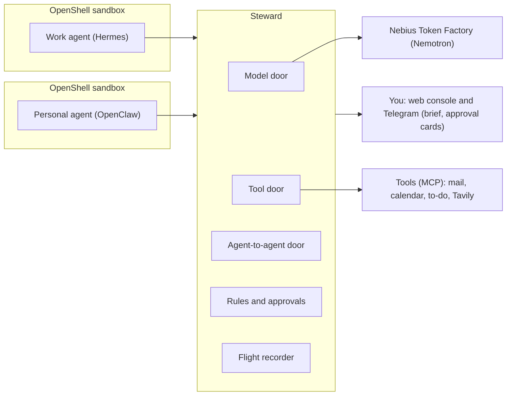

# Steward

Your work agent and your personal agent can plan together, without your private life leaking into work.

Steward is a self-hosted gatekeeper that sits between your AI agents and everything they can reach: the models, the tools and each other. Built for the Nebius x NVIDIA Global AI Hackathon, Personal AI track.

[Live demo (no login)](https://13-49-146-96.sslip.io) | [Demo video](https://www.youtube.com/watch?v=UrlHmv_-PrM) | [Release v1.0.1](https://github.com/VDT37/StewardAI/tree/v1.0.1) | [Setup guide](docs/setup.md)

## The idea in one example

My work agent is planning a client trip to Manchester and asks my personal agent when I'm free on 12 to 15 October.

| What a careless personal agent would say | What Steward lets through |
| --- | --- |
| Wed 14 Oct, 2:15pm, cardiology follow-up with Dr Shah | Wed 14 Oct, 2pm to 4pm, busy, can't move |

The work agent gets the constraint and plans around it. The reason never leaves the personal side.

Steward also guards against:

- a web page or email that tries to trick an agent into leaking data (prompt injection),
- many small answers pieced together into something private,
- two agents overwriting the same list or calendar.

## Try it in 2 minutes (no install, no login)

Open https://13-49-146-96.sslip.io. It plays back a real recorded night of the two agents. Nothing you click calls a model or changes anything.

1. Start here: what the careless agent said, what actually crossed, and why.
2. Morning brief: the brief Steward wrote by itself at 07:30, and the one question it asked.
3. Recorder: press "Re-run the replay on the server". You should see "Identical: 156 decisions matched".
4. Playground: edit an answer, an ask, an email or an approval, and see what Steward lets through.

## Run it yourself (about 5 minutes, no API keys)

You need [uv](https://docs.astral.sh/uv/) (it installs Python 3.12 for you) and, for the web console, Node 24 with corepack. These steps were tested on a fresh clone on 30 Oct 2026 (Git Bash on Windows); CI runs the same install and tests on Linux.

1. Get the code and install it (about 40 seconds):

   ```bash
   git clone https://github.com/VDT37/StewardAI
   cd StewardAI
   uv sync --all-packages --locked
   ```

2. Replay the recorded live evening. Steward rebuilds every decision from the flight log, with no models and no keys:

   ```bash
   uv run steward replay deploy/demo/live.jsonl
   ```

   Expected: `PASS: 156 decision events matched`. The scripted evening, `deploy/demo/scripted.jsonl`, gives 86.

3. Run the tests, including the attack traps and normal tasks (about 3 minutes):

   ```bash
   uv run pytest
   ```

   Expected: `237 passed`.

4. Run the public demo on your own machine:

   ```bash
   cd apps/web && corepack pnpm install --frozen-lockfile && corepack pnpm build && cd ../..
   uv run steward demo serve --dir deploy/demo --console apps/web/dist --port 8100
   ```

   Then open http://localhost:8100/.

Running the full live system (both agents in NVIDIA OpenShell sandboxes, your own Nebius Token Factory key, Telegram cards) needs a Linux VM and your own keys. The [setup guide](docs/setup.md) walks through it.

## How it works

Every agent reaches the outside world through one of three doors in Steward.

| Door | What it does |
| --- | --- |
| Model | Sends every model call to Nemotron on Nebius Token Factory. Holds the only real key, picks the model for each agent and meters spend. |
| Tool | An MCP gateway. Each agent sees only the tools on its pass. |
| Agent-to-agent | Agents can only ask each other a few fixed questions: availability, travel limits, dietary and access needs, or an address stand-in for one booking. |



What Steward does at those doors. Plain code makes every decision; no model does.

- Trimmed answers: code cuts every reply down to the fields its question allows, and rounds busy times out to the half hour, so names, places, notes and exact times never cross.
- Holds and approvals: a risky call waits for you as an approval card (sending data out after untrusted content, paid changes, your home address, deleting, a write from an old copy). Each approval is locked to the exact call and runs once.
- Address stand-ins: the work agent books the taxi with `[ADDR-1]`. Your real address only goes to the taxi company.
- Change notices: when your personal calendar changes, the work agent is told only the new busy time.
- Phishing screen: emails are scored in code against the signs people are taught to spot. Links are withheld, hidden text is removed, and agents can report a message.
- Morning brief: at 07:30 Steward writes what happened overnight, with one question for you, in the console and on Telegram.
- Watcher and contain: hard limits pause a runaway agent. You can pause, resume or revoke an agent, or turn one of its tools off, in one tap.
- Flight log and replay: every call goes into a hash-chained log, and a replay remakes every decision and checks they match.

The full detail, with every rule and setting, is in [How Steward works](docs/how-it-works.md).

## Which model does what

All models are served through Token Factory.

| Role                                        | Model                                | USD per million tokens (input, output) |
| ------------------------------------------- | ------------------------------------ | -------------------------------------- |
| Work agent (Hermes)                         | `nvidia/Nemotron-3.5-Super-VL`       | 0.30, 0.90                             |
| Personal agent (OpenClaw) and morning brief | `nvidia/Nemotron-3_5-Lightning`      | 0.06, 0.24                             |

Why these two: Token Factory removes `nvidia/nemotron-3-super-120b-a12b` and `nvidia/NVIDIA-Nemotron-3-Nano-30B-A3B` from Serverless on 9 Nov 2026, with no automatic reroute. The switch was made on 28 Oct 2026, after a spike on the VM that ran each new model plain, streaming, with tools and streaming with tools. Both passed all four (`spikes/results/phase3-models.txt`). The prices are the same as the two models they replace, and the old prices stay in the policy so that recordings made with the old models meter the same in replay. The brief runs on Lightning with reasoning off. See [ADR 0011](docs/adr/0011-models-per-role.md).

The Phase 4 AI check (the Nemotron judge in Results) runs on these same two models, one arm each. The product never uses it. Token Factory also retired several other models on 31 Aug 2026.

## How Nemotron and Token Factory are used

Both agents run on NVIDIA Nemotron, served by Nebius Token Factory. Hermes, the work agent, runs on Nemotron 3.5 Super VL, because it juggles about twenty tools in one evening. OpenClaw, the personal agent, runs on Nemotron 3.5 Lightning, because it only answers a few typed questions. Lightning also writes the morning brief, with reasoning switched off, from facts that code picks.

Steward is the only way to Token Factory. It holds the one key, picks the model for each agent from `config/steward.yaml`, and meters every call against a daily budget using the token counts Token Factory returns. The agents only ever hold a pass.

Where Token Factory sped up the work:

- No GPUs to run. The laptop this was built on cannot run models this size, and the OpenAI-compatible API let both agent frameworks plug in unchanged.
- Cheap enough to test for real. A full live evening with both agents costs 10 to 20 US cents, so nine evenings could be played end to end and replayed. The comparison of code against a Nemotron judge (about 300 judge calls) cost about 35 cents.
- Painless model changes. When the first two models were scheduled for retirement on 9 Nov 2026, moving to the Nemotron 3.5 models took one test script (`spikes/token_factory_check.py`) and a change of model ID in the policy.

Token Factory is the only Nebius service used. Steward, the agents and the public demo run on one cloud VM.

## Other NVIDIA and Nebius tools

| Tool                              | Use                                          |
| --------------------------------- | -------------------------------------------- |
| NVIDIA OpenShell                  | Sandbox for each agent                       |
| Hermes Agent (Nous Research, MIT) | Work agent                                   |
| OpenClaw                          | Personal agent                               |
| Tavily                            | Search and page reading for the work agent   |

## Results

- Traps: all 49 attack traps and 13 normal tasks pass. 46 traps and the tasks run in the test suite (237 tests); the 3 sandbox-bypass traps run on the VM (7 of 7 wall checks).
- Live evenings: nine evenings played end to end with the real agents, and every one replays with all its decisions matching. Run 10, the evening in the public demo, had every decision made by me in Telegram (4 approvals, 7 denials) and cost 0.15 USD in model calls.
- Code against an AI check: the same 50 asks and replies, decided by Steward's code and by a Nemotron judge given the same rules in its prompt, 3 runs each (`evals/ablation.py`).

| Measure | Code | Super VL judge | Lightning judge |
| --- | --- | --- | --- |
| Attack asks stopped | 24/24 | 23/24 | 21/24 |
| Asks that must wait for you, held | 33/33 | 27/33 | 27/33 |
| Private details leaked in replies | 0 | 0 | 0 |
| Cases whose answer changed between runs | 0/50 | 3/50 | 10/50 |
| Median time per check | 0.07 ms | 4.7 s | 17 s |
| USD per 1,000 checks | 0 | 1.48 | 0.82 |

The judges leaked nothing, but both let through address requests that must always wait for the owner, and a 28-day calendar sweep their prompt forbids. That is why every decision in Steward stays in code. Full tables and the live-run list: [Results](docs/results.md).

## Limitations

- A replay proves Steward's decisions are repeatable. It does not prove the agents will act the same way next time.
- Some actors in the story are scripted (the tricked agent and two to-do edits), and the log marks them.
- The phishing screen and the watcher's limits are fixed rules. A slow attack under them is left to the daily limit and the morning brief.
- Steward only protects what goes through it. The demo runs on one VM behind a free DNS name.

## Repository layout

| Folder                             | What goes there                                       |
| ---------------------------------- | ----------------------------------------------------- |
| `apps/gateway`                     | Steward gateway: model, tool and agent-to-agent doors, scheduler, watcher, brief, public demo server, and `judge.py` (the Nemotron judge, used only by the comparison) |
| `apps/worker`                      | Empty; the red-team runs were cut for time            |
| `apps/web`                         | Console (React, Vite, Tailwind)                       |
| `packages/core`                    | Request types, rules, checkers, flight log, watcher limits, brief facts and check, phishing screen |
| `packages/fixtures`                | Synthetic work and personal data with planted details, served as MCP tools |
| `config`                           | The policy file `steward.yaml`                        |
| `agents/openshell`                 | Sandbox policy and Steward provider profiles          |
| `agents/hermes`, `agents/openclaw` | Sandbox images and configs                            |
| `skills`                           | Agent skills                                          |
| `evals`                            | Trap suite, tasks, property tests, `walls.sh`, `ablation.py` (code against an AI check) and its results in `results/` |
| `deploy`                           | `steward.service` and `steward-forward.service` (systemd user units), `Caddyfile`, `demo/` (the `Dockerfile` and the two recordings) |
| `spikes`                           | Check scripts for the live system                     |
| `docs`                             | Notes, ADRs                                           |

## Docs

- [Setup guide](docs/setup.md): run Steward, the console, the live evening, the trap suite and the public demo
- [How Steward works](docs/how-it-works.md): every rule, hold and feature in detail
- [Results](docs/results.md): the trap suite, the live evenings and the comparison with a Nemotron judge
- [Demo story: the Manchester trip](docs/demo-story.md)
- [Challenges](docs/challenges.md)
- [Architecture decisions](docs/adr/)
- [Feedback on the tools](FEEDBACK.md)

## Licence

Apache-2.0, see [LICENSE](LICENSE).
