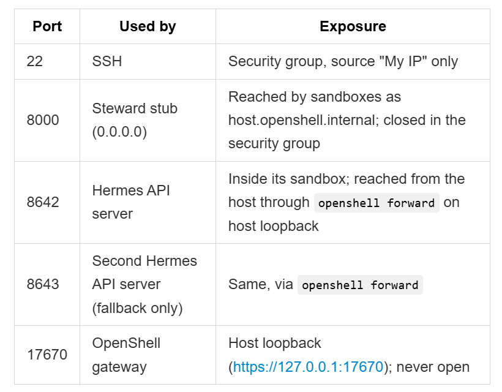

FEATURES

Run personal AI system -> Web app, a self-hosted service with web console, can be installed as a PWA (like outlook web, whatsapp)

Hermes: Work Agent (MCP client, API server steward can call, MIT licence, Tavilly search tool call)

OpenClaw: Personal Agent

Models: (Through token factory)

1. Nemotron 3 Super for Work - nvidia/nemotron-3-super-120b-a12b

2. Nemotron Nano for Personal and the brief - nvidia/NVIDIA-Nemotron-3-Nano-30B-A3B

3. Nemotron ultra for heavy reasoning - nvidia/Nemotron-3-Ultra-550b-a55b

Hosting: AWS EC2 Ubuntu VM, Docker compose (Agents need a docker host). Red-team and eval runs also run on the VM; Nebius Serverless skipped for now (no AI Cloud credits)

Updates: Notion

Ablations: Jev and AI checks

Licence: Apache-2.0 from day one

What we ship: Steward service in Docker compose

- gateway, API, worker, Postgres

Development: VM only. OpenShell and the agents run only on the AWS VM; the laptop is for code, git, docs and tests

FEEDBACK.md with feedback on usage of Nvidia services.

Steward guards its agents on Linux environment

VM SIZE (Always On):

AWS EC2 t3.xlarge (4 vCPU, 16 GB RAM), because out setup would be:

- OpenShell Gateway

- Hermes

- OpenClaw

- Steward

- Postgres

- Web dashboard

Ubuntu Server 24.04 LTS x86_64 (80 GB SSD drive). It stores:

- Ubuntu

- Docker images

- OpenShell

- Logs

- Source code

- Databases

Docker images pile up, and AWS disks are generous, they can easily be enlarged

One Elastic IP (one fixed address; without it IP might change)

SSH only security (blocking web traffic and other ports)

Cost:

- VM: about $0.19 per hour or $4.5 per day (if left on)

- Public IPv4 address: $0.005 per hour (Stopped instances will still keep Elastic IP)

- Gp3 storage for Ubuntu: $7 per month, because even if the server is stopped, disk remains so it costs money.

Where the Code runs:

- Agents run only inside the sandboxes (never directly on the VM)

- Early version Steward, Docker daemon, OpenShell gateway run on the VM host

- Docker daemon is a service that creates, starts, stops, and deletes the sandbox containers

- OpenShell gateway manages openshell sandboxes

- All of these are security enforcers

- Laptop is only for git, docs, tests

- Code Changes Workflow: Push from Laptop, Fetch in VM (fetch only know what branch the change was done) and switch, or git pull after merging.

- VS Code Remote-SSH for viewing logs, editing files, inspecting configs, directly connected to the VM. No need of tunnelling to VM through a SSH call. Github CLI in VM.

How does Sandboxes talk to Steward:

Steward listens on Port 8000 and binds to 0.0.0.0 (anything the host sees can reach it). It is available on every network interface of the AWS VM. AWS firewall still blocks the internet from reaching it.

Why not bind to localhost? sandboxes reach host services as host.openshell.internal. Inside the sandbox, the localhost means the sandbox itself, not the host VM, i.e, Agent in the sandbox would point at the sandbox itself (can only look inside its own container). OpenShell provides host.openshell.internal which means the VM hosting the sandbox. This is not loopback, i.e, not the local host 127.0.0.1, it’s some network address that reaches the host. Loopback is not authorized, otherwise an agent could potentially attack servers running inside locally.

Ports Breakdown:

