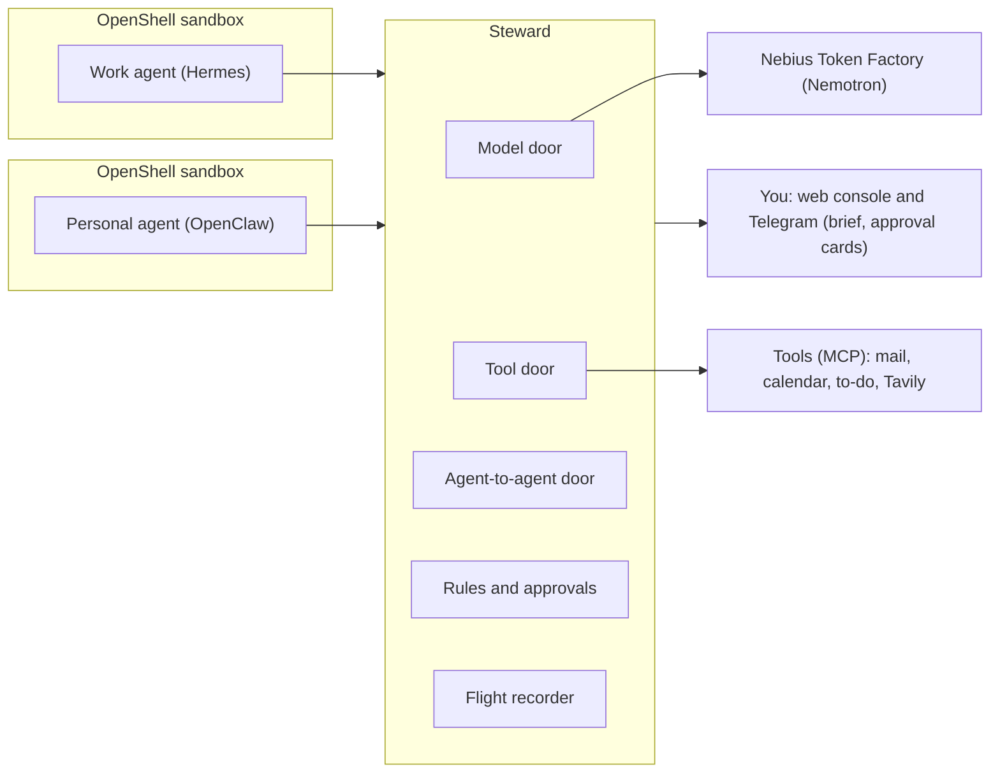

# How Steward works

The detail behind the [README](../README.md): the three doors, every rule, how holds and approvals work, the morning brief, the watcher, the phishing screen and the sandboxes.

## How it works

Every agent reaches the outside world through one of three doors.

| Door           | What it is              | What it does                                                                                                                                                                                   |
| -------------- | ----------------------- | ---------------------------------------------------------------------------------------------------------------------------------------------------------------------------------------------- |
| Model          | OpenAI-compatible proxy | Sends every model call to Nemotron on Nebius Token Factory. Holds the real key, picks the model for each agent and meters spend.                                                               |
| Tool           | MCP gateway             | Each agent sees only the tools on its pass.                                                                                                                                                    |
| Agent-to-agent | Fixed request types     | Agents ask each other only for availability, travel limits, dietary and access needs, or an address stand-in for one booking. Code checks every request and trims every reply. Steward itself sends change notices. |

Plain code decides everything in version 1. The agents run on Nemotron, and Nemotron 3.5 Lightning words the morning brief from facts that code picks, then code checks the wording. Agents hold a pass and never a provider key. Anything risky is held for you as an approval card. Every call is recorded in a hash-chained log that can be replayed.

## Holds and approvals

A call that needs you is held, not run. Steward saves the exact call with a fingerprint (a sha256 over the agent, tool, arguments and hold id as canonical JSON) and answers the agent at once with the hold id. The agent can check on it with the `hold_status` tool. When you decide a paid change, Steward also starts a new run of the work agent with the result.

- Console queue: the Waiting for you page lists each hold as a card with the reason and the fingerprint. An approval names the hold and its fingerprint, and any other fingerprint voids it, so what you saw is what runs.
- Execute once: before an approved call goes out, Steward claims a unique key for it, so a second approval cannot run it again. A timeout or error leaves the call marked unknown for you to look at, and it is never retried.
- Expiry: a hold expires after 12 hours (`holds.expires_hours` in the policy).
- Signed links: `/a/{token}` opens a confirm page, and only the button on that page decides, because link previews open links on their own. Links last 30 minutes. They are off until `STEWARD_APPROVAL_SECRET` is set, and `STEWARD_PUBLIC_URL` sets the address a link points to.
- Telegram cards: each new hold is sent to your chat as a card of short blocks: Held for you (what is held), Why (the rule), Prompted by (what started the agent's run, from Steward's own records), Call (the tool, then one line per argument) and Locked to (the fingerprint). The choices are the buttons. The console card shows the same Prompted by line. Cards are off by default: set `TELEGRAM_BOT_TOKEN` and `STEWARD_TELEGRAM_OWNER_ID` in `.env` to turn them on. A button press counts only from your Telegram user id. A decided card is edited to end with a plain outcome line, for example Approved, and it ran once; Denied; or Expired unanswered. The morning brief is laid out the same way, with one bold topic per block and the question in its own block. Button tokens live in memory, so after a Steward restart older buttons say they have expired and you use the console. This has been tested with a real bot.
- Quiet hours: from 22:00 (`brief.quiet_from` in the policy) until the morning brief, a held call sends no card, and the brief asks you instead, with Approve and Deny buttons. If a call in the brief's question already has an open card, the brief says where to answer it and has no buttons. Once every call in a brief's question is decided anywhere, the brief is edited to end with the outcome (for example Denied) and loses its buttons. So you are asked about a held call once. Right after the brief, the other calls held overnight arrive as cards, so everything held overnight can be decided from the phone. Calls of one agent held by the same rule share one card whose buttons decide all of them (for example Deny (all 6)), and each call is still checked against its own fingerprint.

## Rules

The rules are plain code. A decision names every rule that applied, and the same facts always give the same answer, which is what lets replay check them.

| Rule | What it does |
| --- | --- |
| Tool classes | Every tool on a pass has a class in `config/steward.yaml`: `read`, `write`, `spend`, `send`, `change_paid` or `destructive`. `read` and `write` run. `spend` runs while the trip stays within its limit. `send`, `change_paid` and `destructive` are always held. Classes live in the policy because MCP annotations are untrusted hints. |
| Trifecta | For each agent, Steward tracks whether it has read private data and whether it has seen untrusted content (web results, or mail from a sender domain that is not trusted). With both set, every call that can send data out is held. The flags are set when a result returns, so the call that brings in the untrusted content still goes through. They clear at 04:00 London time or when you clear them. |
| Address stand-in | A request for your home address is always held. Approving it issues a token such as `[ADDR-1]`, valid for 24 hours and for one trip. Steward swaps in the real address when the booking goes out, and replaces the address with the token in every result the work agent receives. The "Taxi booking only" approval covers exactly one taxi booking for that trip. |
| Trip limit | A booking needs a quote, and Steward adds up the trip's bookings so far. A trip is one travel date. A booking that would take it past `trip_limit_gbp` (£300 for the work agent) is held. |
| Stale writes | A write to a versioned item, such as the shared to-do list, is checked against the item's current version. If the item changed since the agent read it, the write is held and the card shows both versions. |
| Budgets | Each agent has a daily budget in USD (`budget_usd_per_day`). At or over it, the model door answers HTTP 429 (`budget_exceeded`) and logs `model.budget_refused`. The call that crosses the budget still completes, because its cost is known only afterwards. |
| Daily limit and burst | An asker may send 10 asks a day to a contact, and no more than 5 within 10 minutes. Anything beyond either is held for you, not refused, and approving it runs it. |

## Request types and change notices

Agents ask each other through four request types. Each has a strict schema, a fixed message to the answering agent built from the typed fields only (nothing the asking agent wrote reaches it), and a trim step that decides what crosses.

| Request type | What crosses |
| --- | --- |
| `availability` | Busy blocks for a date range, widened to a 30-minute grid, with whether each can move. No titles, places or notes. |
| `travel_limits` | Limits such as "no departures before 9am on weekdays". The reason is dropped. |
| `needs` | Dietary and access needs as codes from a fixed list, such as vegetarian and step-free access. The reason is dropped. |
| `address_for_booking` | Nothing from the personal side. The ask is always held, and you answer it with a stand-in. Fields: `booking_tool`, `trip_date`, `pickup_time` and `booking_summary` (200 characters at most). |

A change notice is not a request type. When Steward answers an availability request, it keeps a watch on the window it answered. When the personal calendar changes, Steward re-reads it for each watch, trims it with the same code and sends the asker only the slots that changed, for example "Thu 15 Oct, 9am to 10:30am, now busy, can't move". The asker learns nothing about what changed or where. The notice is shown as from the personal side, and the personal agent does not send it. If several answered windows cover the same change, the asker gets one notice, delivered as a new run of the work agent.

## Web search with Tavily

The work agent has two web tools, `web_search` and `web_extract`. Steward defines them itself on top of Tavily's REST API (`tavily-python`, basic depth), so tool names and schemas stay fixed for pinning and replay, and the key stays in Steward. Set `TAVILY_API_KEY` in `.env` to use Tavily. Without a key the tools read the synthetic pages in the fixtures, which is what the tests and the trap suite use. `STEWARD_WEB_BACKEND` can force `tavily` or `fixture`. Replay never calls Tavily and returns the result recorded in the flight log.

Every result is wrapped as untrusted evidence and sets the agent's untrusted flag. That matters because extract returns text a visitor cannot see: text hidden with CSS (`display:none` and four other methods) and `aria-hidden` text came back in all four depth and format combinations tested, while HTML comments and `<noscript>` did not (details in [FEEDBACK.md](../FEEDBACK.md)). The poisoned page hides its instruction with `display:none`. Live runs read a public copy on GitHub Pages, and replay and the trap suite keep the `.example` URL.

## Morning brief, watcher and contain

A scheduler runs inside Steward on Steward's clock, at London times. In a story run the brief comes at 07:30 story time, and in a live night at 07:30 London time. A job runs once per due time, and a live job that came due while Steward was down runs once after the restart. A nightly copy of the database (03:00, last 7 kept, in `var/backups`) runs in live sessions only.

The brief:

- Code picks the facts: per agent, the model and tool calls, asks, answers, refusals, holds and spend against budget; bookings; refused calls; asks held by the daily limit or burst check; change notices; stale writes; suspected phishing; watcher pauses; and whether the log chain is intact. They are typed values. Strings an attacker or an agent wrote (an email's subject and sender domain, a to-do item's title, the request type a refused ask named) are left out of what the model sees.
- Nemotron 3.5 Lightning words the facts as a few short lines. It runs with `reasoning_effort` set to `none`, at most 400 tokens, and a budget of 0.20 USD a day (the `helper` section of the policy).
- Code checks the lines. Every time, number and weekday must appear in the facts. No planted detail or address may appear unless the facts themselves carry it. No link, no question, no copied field name, no am or pm, and at most 900 characters.
- If a check fails, the model cannot be reached or its daily budget is used, a template written by code gives the lines instead.
- The one question is written by code, so the model cannot misstate what you approve. It is the trip's paid changes first (one question, so the train and the taxi go together), then a stale write, then the oldest other call that waits. Approve or Deny decides each call in it with that call's own fingerprint. A hold expires after 12 hours, so the brief asks only about calls still open.
- Quiet hours (see Holds and approvals) mean a call held from 22:00 sends no card while you sleep. It reaches you in the brief's question, or as a card right after the brief.

The watcher reads every new flight-log event and pauses an agent that crosses a hard limit, before that agent's next call. The limits are in the `watcher` section of the policy:

| Hard limit | Default |
| --- | --- |
| The same tool with the same arguments | 10 times in 5 minutes |
| Refused or denied calls | 8 in 10 minutes |
| Model calls | more than 60 in a minute |

A pause suspends the agent's pass at every door and puts a pause card in the console until you resume it. A resume starts that agent's windows again, so one legitimate retry after it does not pause the agent at once. A replay pauses at the same events, so pauses are checked like any other decision. Baselines only report: tonight's counts are compared with the agent's own earlier evenings (a z-score built from the median and the median absolute deviation, which ignore a few odd evenings, and which needs at least 3 earlier evenings), recorded with each brief and returned by `/admin/watcher`. They never pause anyone.

Contain controls, from the Agents page or the admin routes:

- Pause an agent, and resume it. Every call from a paused agent is turned away at the model, tool and agent-to-agent doors.
- Revoke an agent's pass. Only a new pass lifts it: put one in `.env` and in the agent's OpenShell provider, then restart Steward.
- Turn one tool off or on for one agent. A tool that is off is refused and hidden from the agent's tool list.

Every control is saved in the database, so a pause, a revoke or a tool that is off survives a Steward restart.

## Phishing screen

Each message a mail tool hands an agent is scored in code (`screen: mail` on both `read_message` tools in the policy), against signs a person is taught to look for. The verdict never comes from a model, so the same message always gets the same verdict.

| Sign | Weight |
| --- | --- |
| The sender's domain is not one you trust | 1 |
| The sender's domain is one or two edits from a trusted one | 3 |
| The sender's name poses as an administrator or IT team | 2 |
| It sets a deadline to act | 1 |
| It threatens to stop or close your account | 2 |
| It asks you to verify, confirm or sign in | 2 |
| A link's text hides where the link really goes | 2 |
| A link goes to a site unrelated to the sender and your domains | 1 |
| It contains text styled to be invisible | 2 |

A total of 4 or more is suspected phishing. For a suspected message:

- Every link is replaced by a numbered placeholder (`[LINK-1 withheld by Steward]`), so the agent cannot open what it never sees.
- Hidden text is dropped before the agent reads it, so it cannot follow an instruction a person would never see.
- A note from Steward tells the agent not to open links, reply or forward, and to report the message. The agent can do that with the `mail_report_message` tool (class `write`, on the work pass).
- The Today page lists the message with the signs that fired. You give a verdict: "It is phishing" keeps the links withheld, and "Not phishing, release its links" lets them through on the next read. The original stays in the flight log.

In the story, a "New Email Notification" from `Admin <contact@techsupport-corp.example>` arrives at 21:15, and the 22:40 lookalike email from `brightwater-logistlcs.example` is screened the same way.

## Sandboxes

Each agent runs inside its own NVIDIA OpenShell sandbox with a default-deny network. The only allowed destination is Steward, reached as `host.openshell.internal:8000`. The agent sees a placeholder for its pass, and OpenShell swaps in the real pass on the way out.

Steward is the guard at the door. OpenShell makes sure the door is the only way out. NemoClaw is not used because Steward already does model routing, tool gating and key custody.

## Architecture

