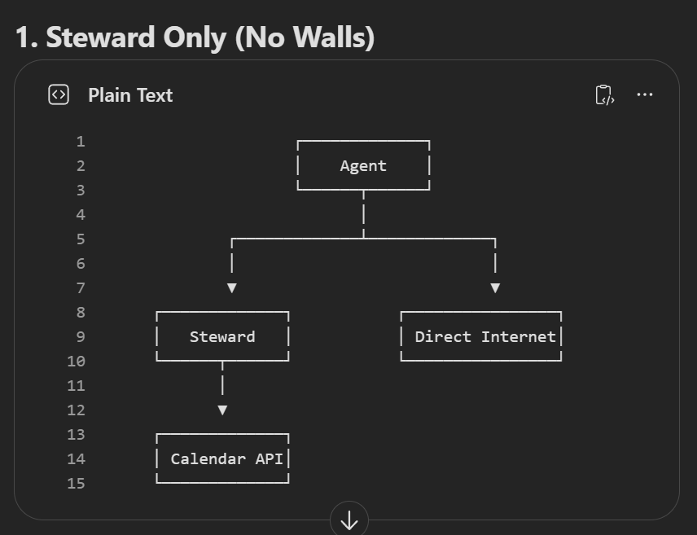
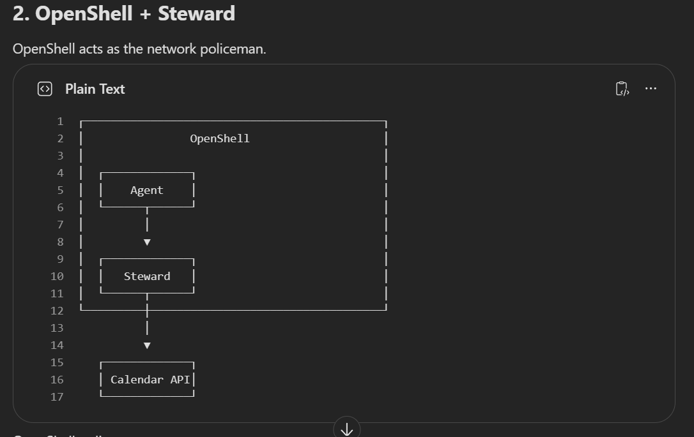
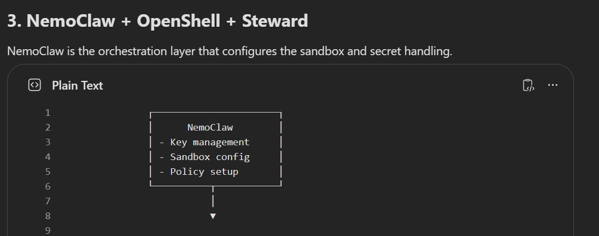
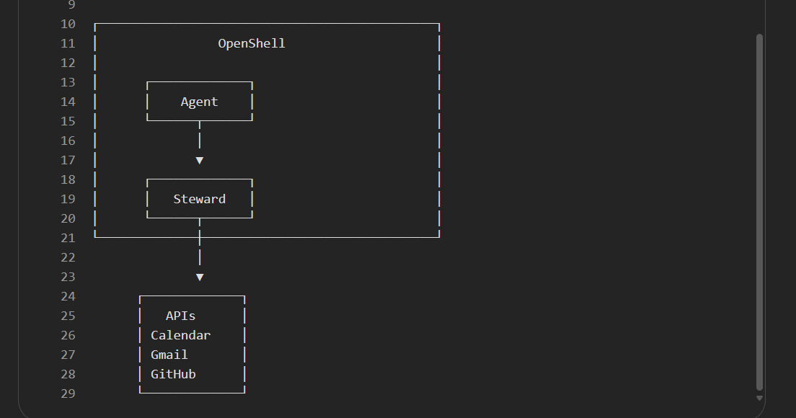

Questions and Doubts

Q: Why Steward isn't enough? And why we need OpenShell?

Ans: Both keep keys away from agents, but they differ in jobs

Openshell is like a room with only one door. It will only allow specific IPs (which we decide before) to pass thorugh its door and reach the agent.

While Steward is like a guard that checks every response of the Agent

Openshell enforces the walls at system level, while Steward is just a server which only sees the traffic that is sent to it. It can't stop agent from going around it (agent could post requests and ignore steward)

Openshell guarantees that the agent can only talk to Steward, while Steward guarantees only safe info leaves it.

Can't we build system-level restriction? like Docker network rules

hackathon proposes to use OpenShell if needed.

We'll implement bypass tests (fake attacks that tell an agent to read the key file, steal the other agent’s pass, send data straight to an attacker website, or call Token Factory directly)

Q: OpenShell and NemoClaw

A: OpenShell is NVIDIA's open-source sandbox. It controls which websites and servers the agent can have access to. It has its own set of CLI commands which we can use.

NemoClaw is a guided setup added on top of OpenShell. It writes the sandbox rules for us, routes model calls, and stores keys outside the agent.

Simple Visualisation:

Agent can bypass Steward and call APIs directly

Openshell policy:

Allow:  steward.local; Block:  everything else

Agents can’t bypass Steward, and Steward inspects every action

Q: Does Steward actually need NemoClaw?

A: OpenShell on its own gives you the walls. Their ecosystem page describes an “OpenShell path” where you bring your own container, policy file and provider setup.

Steward already does the model routing, tool gating, and key handling. It only needs a well-built sandbox (Network isolation, filesystem restrictions, filters, privilege dropping, etc), so that agent reach only steward and nothing else on the internet. Openshell can also hide the pass behind a placeholder and swap in the real value on the way out.

Example:

Say Steward uses a token (“pass”) to access your calender. The agent receives this pass.

PASS = stewd_abc123xyz

Agent request: steward.get_calendar("stewd_abc123xyz")

Problem is:

- The agent can see the pass.

- It might accidentally log it.

- Another agent might steal it (A prompt injection might reveal it)

OpenShell approach:

Instead of giving the pass, it gives a placeholder (bound to specific sandbox):

PASS = ${MY_STEWARD_PASS}

Agent req: steward.get_calendar("${MY_STEWARD_PASS}") (Openshell intercepts the agent requ before it goes out and replaces it with the pass)

Agent doesn’t know what the key is, what the pass, it just knows that there is a placeholder

This placeholder is bound to agent’s sandbox, so the agent outside the sandbox can’t use the same placeholder.

Steward has almost everything (with OpenShell) that NemoClaw has except for state management and some more non-essential operations. We can do an ablation with it if needed. Moreover, NemoClaw needs more RAM, and very structv about which addresses it accepts.

Q: Docker vs NVIDIA OpenShell?

A: Docker is a general-purpose containerisation platform providing infrastructure-level host isolation (packages and deploys standard applications), where as OpenShell is a specialised security runtime platform (multi-layered sandbox using docker container, podman, and a microVM) designed specifically to manage, monitor, and sandbox unpredictable autonomous AI agents.

Docker has a broad networking configurations compared to OpenShell which uses Deny-by-default proxy.

- The Docker Layer: Docker creates the container (the "room") so the agent doesn't execute malicious or accidental rm -rf commands directly on your physical host machine.

- The OpenShell Layer: OpenShell sits inside and around that container. It prevents the agent from abusing its environment. For example, if the agent tries to steal your AWS credentials from environment variables, read files outside its designated directory, or secretly upload data to a random IP address, OpenShell's policy engine catches and blocks it.
